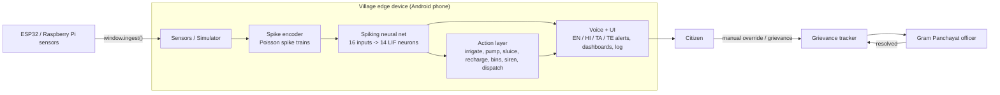
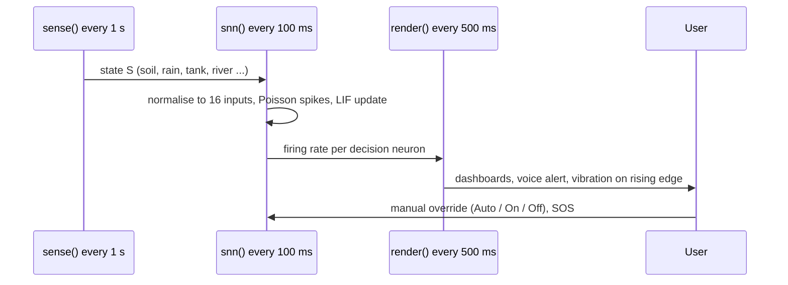

# Technical Design Document — NeuroGram AI

## 1. Problem
Villages notice leaks, floods, dry spells and overflowing waste too late; connectivity is weak; services are scattered; language and literacy barriers exclude farmers, women, elders and persons with disabilities.

## 2. Solution overview
A single offline Android app (WebView over a one-file HTML5 app) running an on-device spiking neural network that converts sensor readings into spikes and then into actions and multilingual voice alerts.

## 3. System architecture

## 4. Data flow

## 5. Spiking neural network design
- **Inputs (16):** Soil dry, Heat, Rain, Tank low, River high, Dark, Battery low, Leak signal, Drain high, Drain clogged, Bin full, Methane high, Disaster risk, Grievance pending, Rooftop high, Pond low. Each sensor is normalised to 0-1 and encoded as a Poisson spike train.
- **Decisions (14):** Irrigate, Fill tank, Flood alert, Lights on, Save energy, Leak alert, Open drain, Clog alert, Bin pickup, Mix compost, Disaster siren, Dispatch officer, Recharge aquifer, Fill pond.
- **Weights:** a 14 x 16 synaptic matrix (excitatory and inhibitory), e.g. Irrigate is excited by dry soil and heat and inhibited by rain and a low tank.
- **Neuron model:** leaky integrate-and-fire; network stepped every 100 ms.
- **Decision rule (edge-triggered):** firing rate over a 20-step window; an action turns ON above 0.30 and OFF below 0.12 (hysteresis prevents flicker). Spikes occur only on change, which is the source of the compute saving (85-94% vs always-on, measured in prototype simulation).
- **Crop targets:** Tomato 55, Rice 70, Wheat 45, Millet 35 (soil moisture %).

## 6. Modules (screens)
| Screen | Purpose |
|---|---|
| AI Brain | Live spike raster, neuron activity, scenario buttons |
| Farm | Soil moisture, crop advisory, irrigation valve and pump (Auto/On/Off) |
| Water | Tank, leaks, river, pipe status |
| Harvest | Rooftop rainwater, pond, aquifer recharge, water saved |
| Drainage | Drain level, clog, sluice gates |
| Energy | Solar, battery, load, lighting |
| Waste | Bins, compost, methane, biogas |
| Grievance | Citizen tickets routed to Gram Panchayat |
| Schemes | PM-KISAN, JJM, PMFBY finder |
| Alerts | Alert history, SOS, activity log |

## 7. Sensor interface (`window.ingest`)
`ingest(obj)` merges fields into the state and switches the app to live mode. Fields: `soil, temp, hum, rain, tank, river, roof, pond, aquifer, drain, clog, off, solar, bat, bin, methane, ctemp, biogas, disaster, grievance, hour, leak, drop`. Units follow the simulator defaults (percent for levels, degrees C for temperature, 0-1 for rain).

## 8. Accessibility and inclusion
Voice alerts (Web Speech API or native `AndroidTTS`), voice commands, read-screen, repeat last alert, large text, dyslexia-friendly font, high contrast, easy mode, screen-reader announcer, vibration and chimes.

## 9. Technology stack
HTML5, CSS3, JavaScript (no framework), Android WebView (Kotlin shell), Web Speech API, Web Audio, ESP32 and Raspberry Pi for real sensing.

## 10. Privacy and security
All computation and data stay on the device; no cloud or run-time API calls; no accounts or API keys.

## 11. Scalability
Modular domains and sensors (add a neuron row/column and a sensor field); more villages by deploying more edge devices; planned GIS layer and live ESP32 ingestion.

## 12. Known limitations
Thresholds are tuned on simulated data; real-world sensor noise needs field validation (planned pilot).
